# Protótipo da nova interface

## Estado

**Aprovado pelo usuário em 03/11/2026 e implementado no lote 12, com a comparação visual em navegador ainda pendente.** A entrega foi feita pelas issues
[#95](https://github.com/adnerscarpelini/ags-controle-financeiro/issues/95) a
[#103](https://github.com/adnerscarpelini/ags-controle-financeiro/issues/103), com as regras de negócio nas issues
[#88](https://github.com/adnerscarpelini/ags-controle-financeiro/issues/88) a
[#94](https://github.com/adnerscarpelini/ags-controle-financeiro/issues/94).

## Como usar

- Os prints abaixo são a referência visual: estrutura, hierarquia, textos e ações.
- Em caso de divergência, **a issue prevalece** nas regras de negócio. O protótipo prevalece na organização da tela.
- A implementação usa MudBlazor (#95) e os tokens de `wwwroot/css/tokens.css`. Não copie o CSS do protótipo para a aplicação.
- Todos os dados são fictícios. Nenhum valor ou cálculo do protótipo é regra do produto.

## Tema escuro aprovado

O fundo verde musgo dá lugar a um cinza neutro quase preto. O verde continua como cor de destaque, e o tema claro não muda.
Os valores abaixo substituem os atuais a partir da [#95](https://github.com/adnerscarpelini/ags-controle-financeiro/issues/95).

| Token | Antes | Aprovado |
| --- | --- | --- |
| `Background` | `#0E1311` | `#121212` |
| `Surface` | `#151C19` | `#1A1A1A` |
| `SurfaceRaised` | `#1C2521` | `#242424` |
| `Border` | `#27332E` | `#2E2E2E` |
| `TextPrimary` | `#E6EDE9` | `#EDEDED` |
| `TextSecondary` | `#93A39B` | `#A3A3A3` |

## Fontes

`ui-prototype/Main.dc.html` e `ui-prototype/Celular.dc.html` trazem a marcação, os textos, os tooltips e os fluxos de cada tela.
Esses arquivos dependem do ambiente em que o protótipo foi criado (`support.js`), então **não abrem sozinhos no navegador**:
leia-os como referência de conteúdo e comportamento, procurando pelos comentários de cada tela, como `<!-- LANCAMENTOS -->`.

## Telas

### Lançamentos
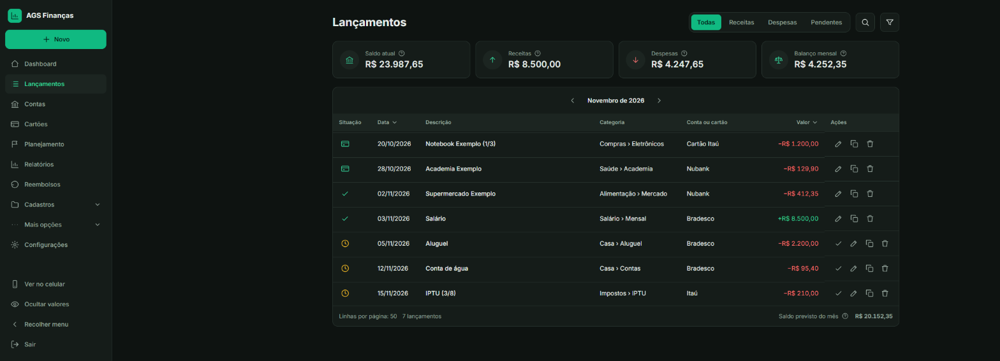

### Nova despesa, com os detalhes abertos
Observação e anexo ficam na coluna direita, abaixo do reembolso. O campo de classificação mostra `Categoria › Subcategoria`.

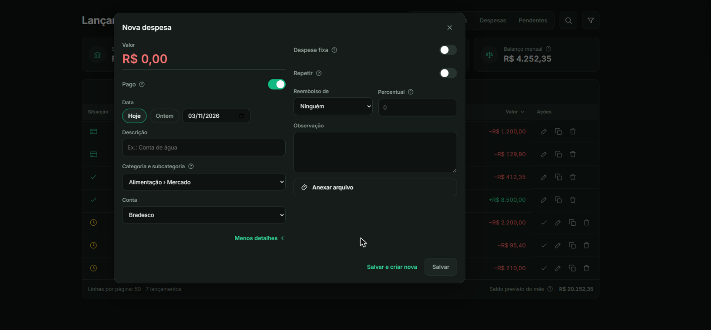

### Nova despesa no cartão
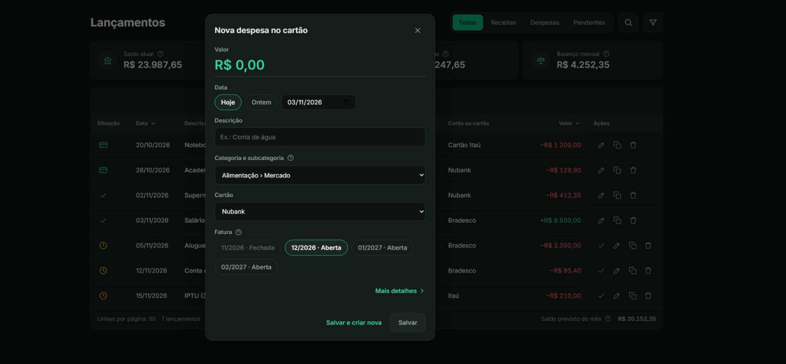

### Dashboard
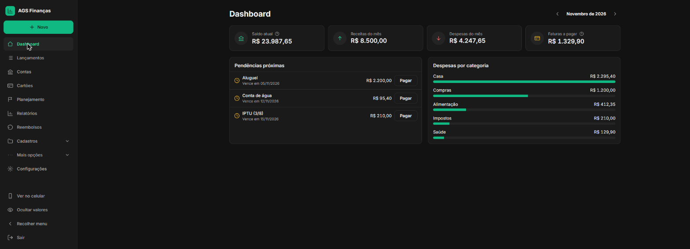

### Contas
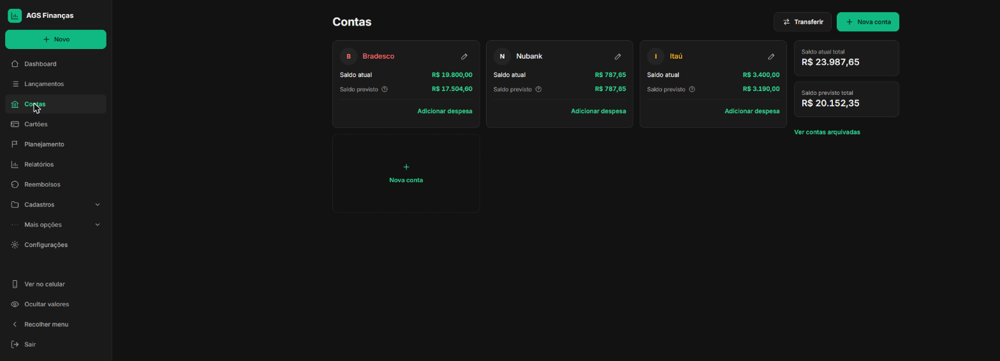

### Cartões
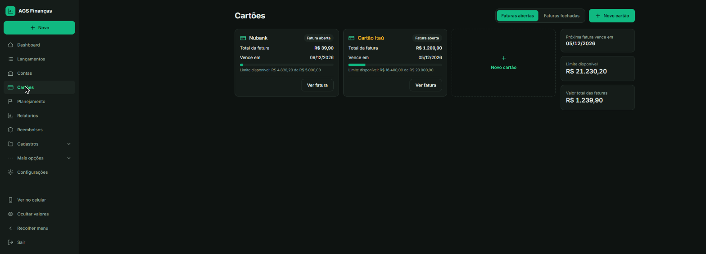

### Detalhe da fatura
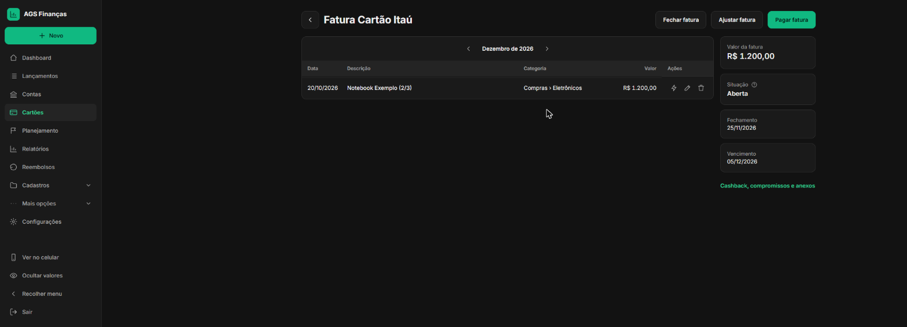

### Planejamento mensal
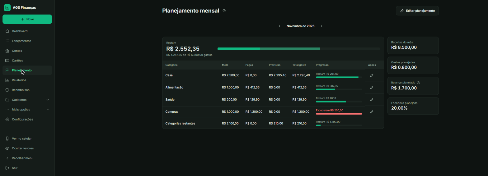

### Relatórios: visão de 19 meses
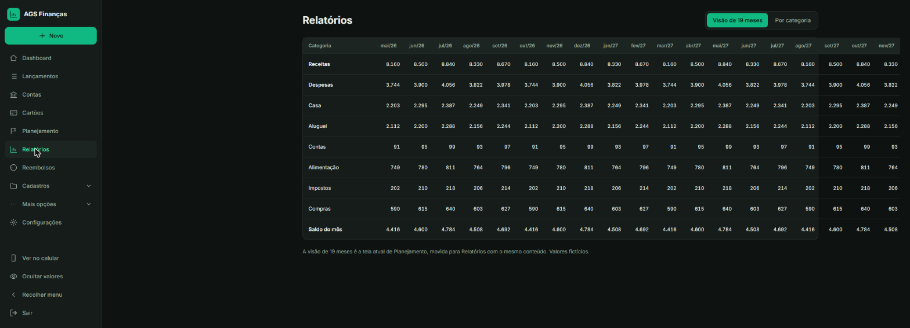

### Cadastros: categorias e menu em árvore
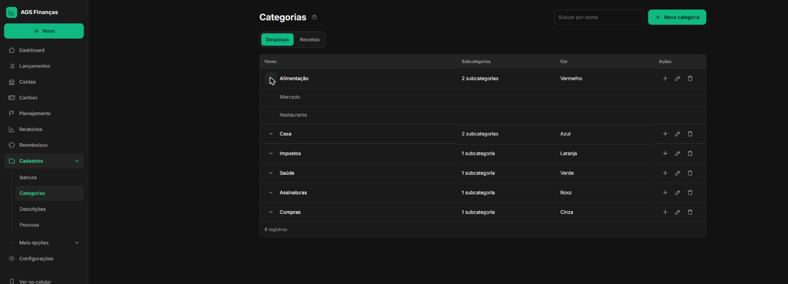

### Celular
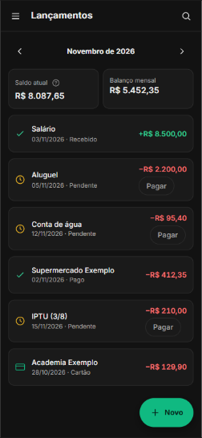

## Consequências

- O protótipo é uma referência temporária. Depois de conferir as telas com ele em navegador, esta nota e a pasta `ui-prototype/` podem ser removidas.
- Mudanças aprovadas na interface antes da entrega devem atualizar esta pasta e as issues afetadas.
