# Galeria de telas

Prints da aplicação com **dados fictícios** do universo Star Wars: bancos, contas, cartões, pessoas
e lançamentos foram inventados só para a demonstração. Nenhum dado financeiro real aparece aqui.
Os nomes são usados apenas como texto, sem logos ou marcas oficiais.

As telas estão no tema escuro (o padrão), num computador a 1440x900, salvo quando indicado.
Origem: [#135](https://github.com/adnerscarpelini/ags-controle-financeiro/issues/135).

## Dashboard

Comportamento do mês pela data da despesa, orçamento do mês, pendências dos próximos dias e atrasadas.

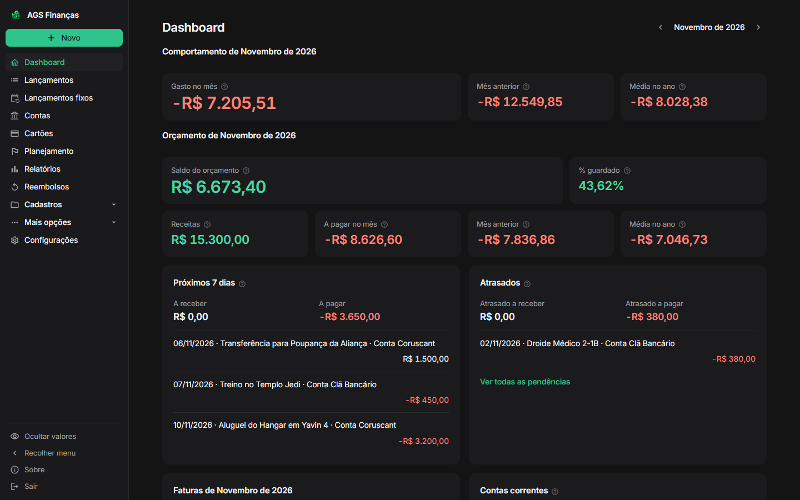

## Lançamentos

Receitas e despesas do mês, com situação (pago, pendente, atrasado ou cartão), categoria, conta ou cartão e totais.

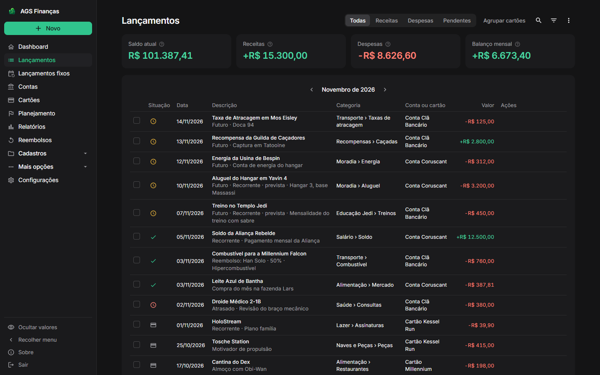

## Lançamentos com Agrupar cartões

Os itens de cada cartão viram uma linha por cartão e fatura, com a soma; os totais não mudam.

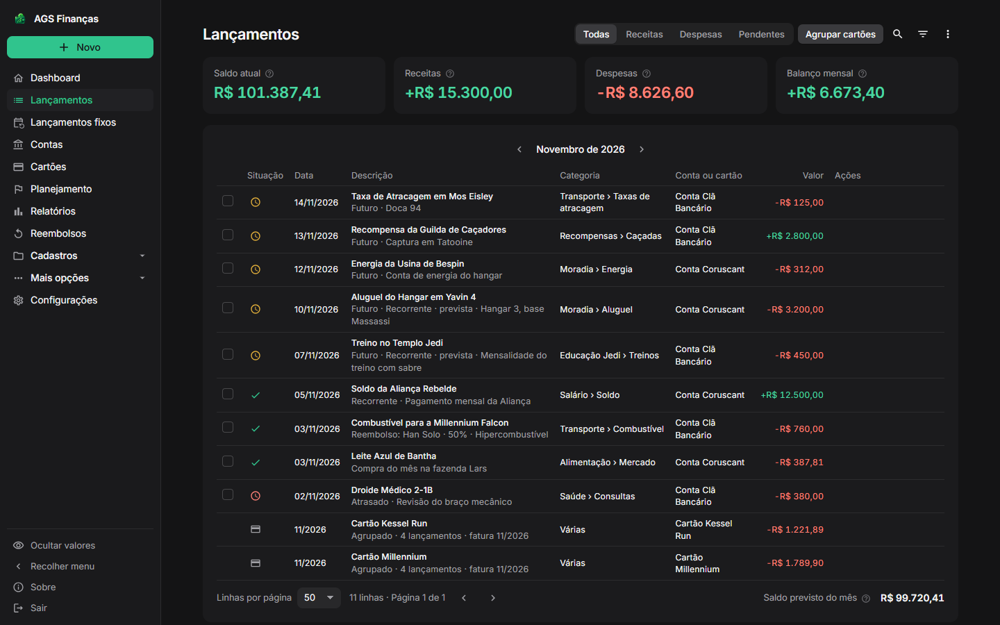

## Lançamentos fixos

Receitas, despesas e transferências recorrentes, no cartão ou na conta, com o dia de cada mês.

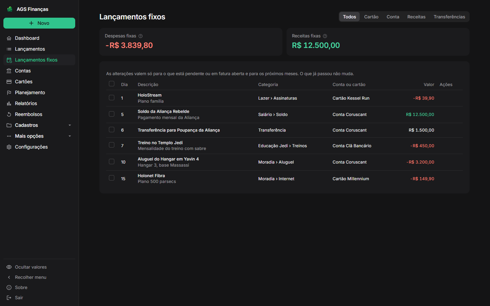

## Contas

Saldo atual e previsto de cada conta e as transferências recorrentes do mês.

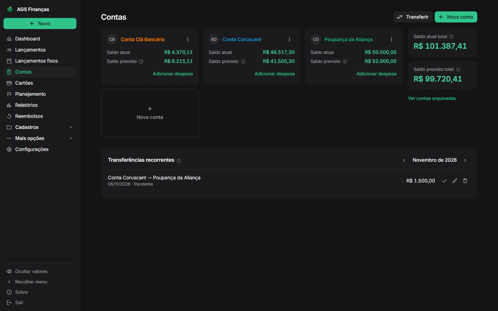

## Cartões

Carteira de cartões com a fatura aberta, o vencimento, o limite disponível e a fatura fechada a pagar.

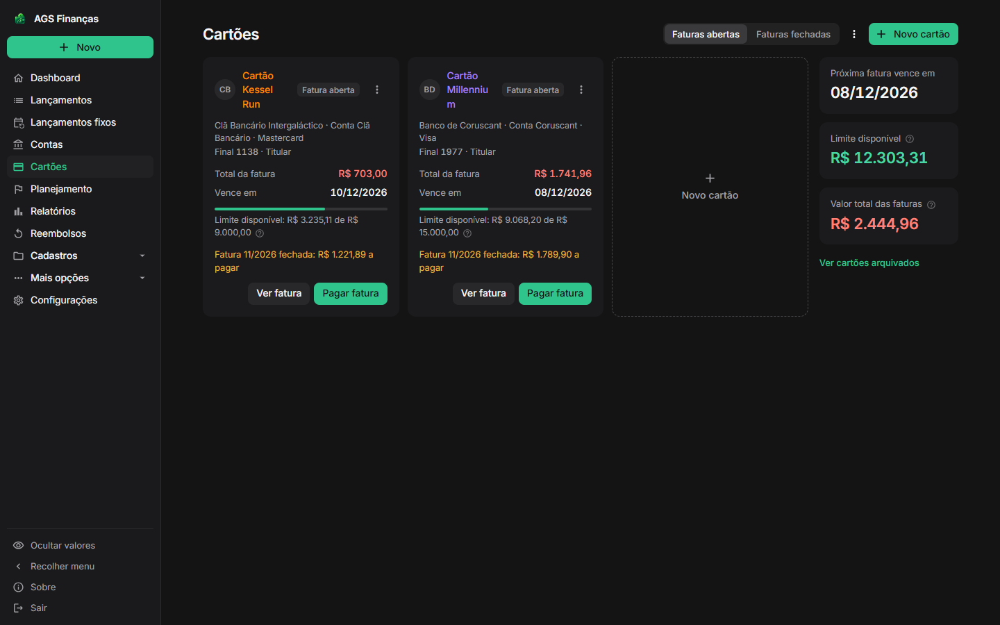

## Detalhe da fatura

Compras de uma fatura Fechada, com parcela, recorrência, fechamento, vencimento e saldo restante.

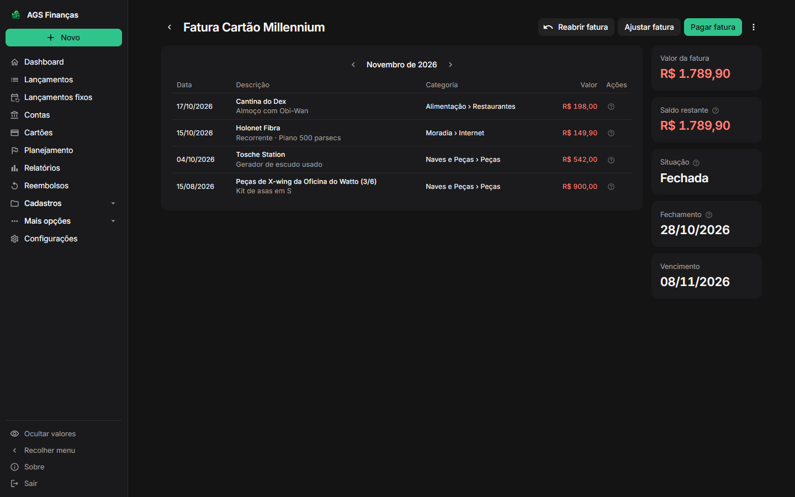

## Planejamento

Orçamento do mês com metas por categoria, despesas pagas e previstas e o que resta ou excedeu.

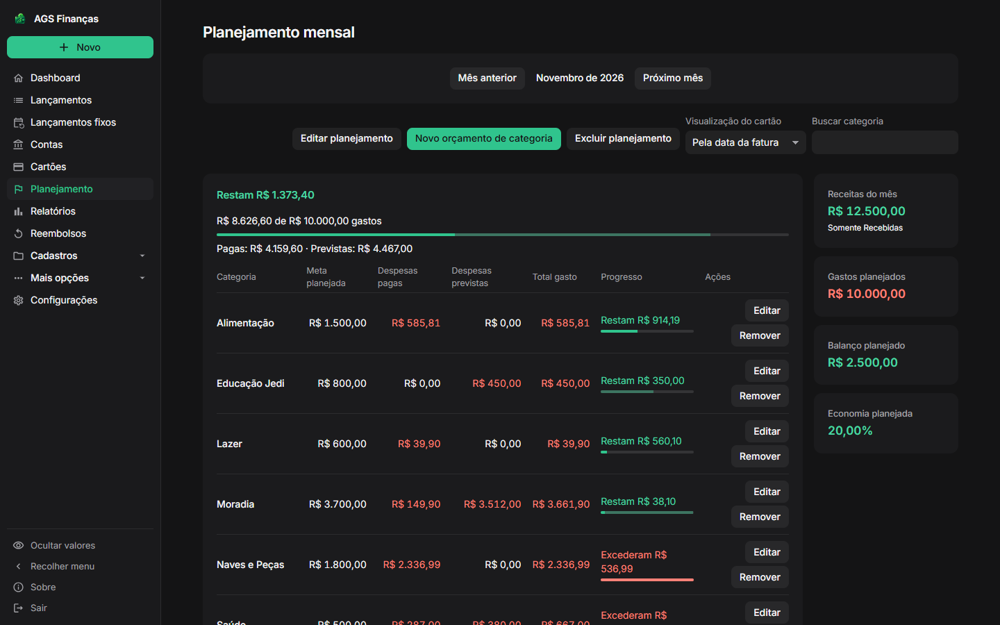

## Relatórios: visão de 19 meses

Receitas, despesas e saldo por mês, abertos por categoria, com previstas em itálico.

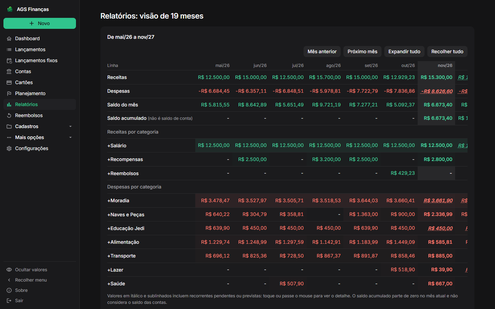

## Reembolsos

Despesas divididas com outras pessoas, com o percentual, o valor a receber e a situação de cada uma.

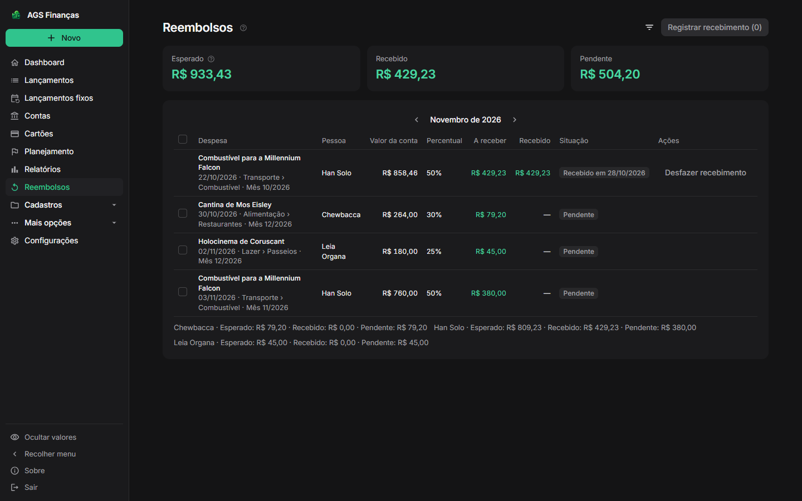

## Nova despesa

Janela de lançamento com valor, situação, data, descrição, categoria e conta.

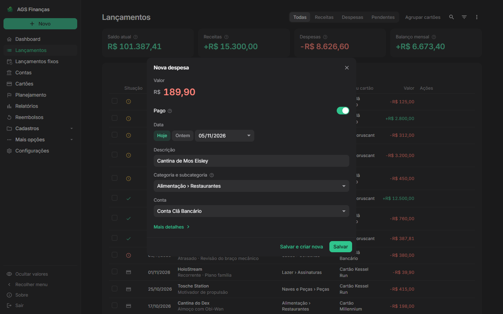

## Configurações

Preferências do aplicativo, como tema e tela inicial.

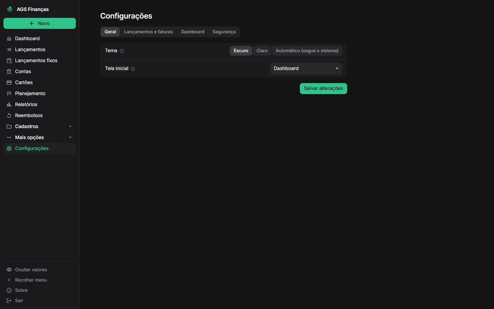

## Sobre

Versão em execução, desenvolvedor e página do projeto.

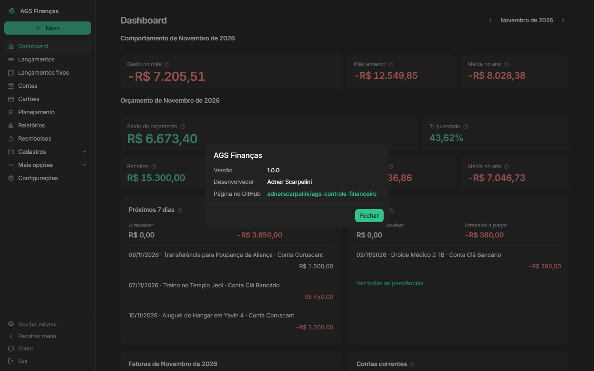

## No celular

Dashboard, Lançamentos e Cartões numa tela de celular (375x812), com o botão Novo flutuante.

  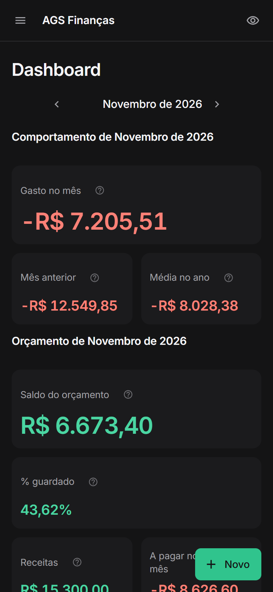
  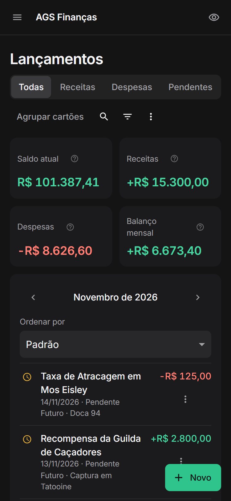
  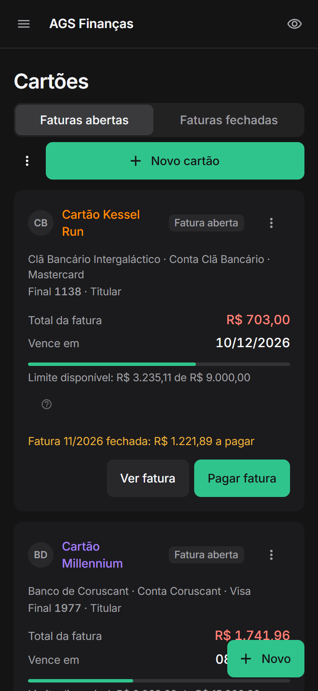

## Tema claro

O mesmo Dashboard com o tema claro, escolhido nas configurações.

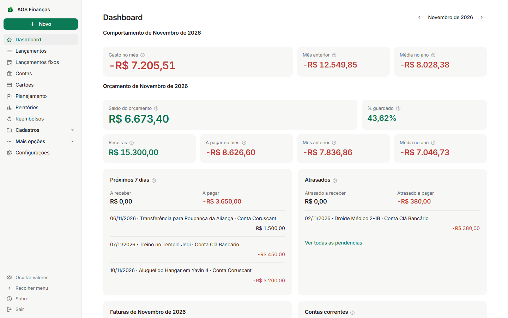
